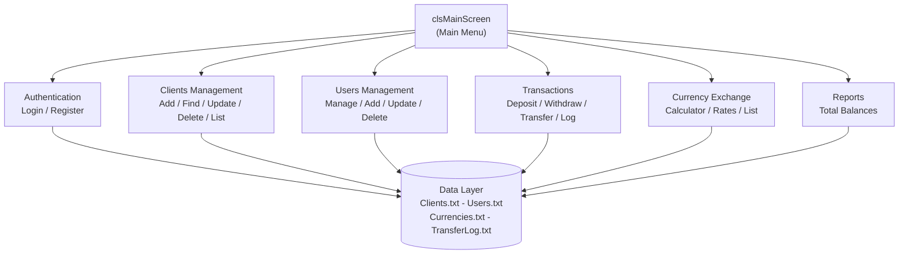
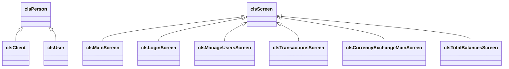

# 🏦 BankCore System

**نظام مصرفي متكامل لإدارة العملاء والعمليات المالية والعملات — مبني بلغة C++**
*A comprehensive console-based banking management system built with C++ and OOP principles.*

<p align="center">
  
  
  
  
  
</p>

---

## 🌟 نظرة عامة | Overview

**BankCore System** هو تطبيق طرفية (Console Application) احترافي يغطي العمليات المصرفية الأساسية:
إدارة العملاء، إدارة المستخدمين والصلاحيات، الإيداع والسحب والتحويل، صرف العملات، والتقارير.

يعتمد المشروع على **البرمجة كائنية التوجه (OOP)** ونمط **Screen-Based Architecture**:
كل شاشة في النظام تمثل فئة (Class) مستقلة ترث من فئة أساسية `clsScreen` وتقدم خدمة واحدة واضحة.

**BankCore System** is a console-based banking application covering clients management,
users & permissions, deposits/withdrawals/transfers, currency exchange, and reports.

---

## ✨ المميزات | Features

| # | الوحدة | Module | الوصف |
|---|--------|--------|-------|
| 1 | 👥 إدارة العملاء | Clients Management | إضافة / بحث / تعديل / حذف / عرض القائمة |
| 2 | 👤 إدارة المستخدمين | Users Management | إنشاء المستخدمين والصلاحيات وإدارتها |
| 3 | 💰 العمليات المالية | Transactions | إيداع، سحب، تحويل بين الحسابات |
| 4 | 💱 صرف العملات | Currency Exchange | حاسبة العملات، تحديث أسعار الصرف، عرض العملات |
| 5 | 📊 التقارير | Reports | الأرصدة الكلية وسجل التحويلات |
| 6 | 🔐 المصادقة | Authentication | تسجيل الدخول وتسجيل مستخدمين جدد مع سجل دخول |

---

## 🏗️ المخطط المعماري | Architecture

> مخطط تدفق النظام (يرسمه GitHub تلقائياً):



> مخطط الوراثة بين الفئات (OOP):



---

## 📁 هيكل المشروع | Project Structure

```text
Project_Back/
│
├── Project_Back.sln                  # Visual Studio solution
├── Project_Back.vcxproj              # MSVC project file
├── Project_Back.vcxproj.filters
│
├── Project_Back.cpp                  # Entry point (main)
├── Source.cpp                        # Additional source file
├── Global.h                          # Global enums and declarations
│
├── clsPerson.h                       # Base class: Person
├── clsClient.h                       # Client class
├── clsUser.h                         # User class
├── clsCurrency.h                     # Currency class
├── clsDate.h                         # Date utilities
├── clsString.h                       # String utilities
├── clsUtil.h                         # General utilities
├── clsInputValidate.h                # Input validation
│
├── clsScreen.h                       # Base screen class
├── clsMainScreen.h                   # Main menu screen
├── clsLoginScreen.h                  # Login screen
├── clsLoginRegisterScreen.h          # Registration screen
│
├── clsAddNewClientScreen.h           # Clients: add new
├── clsDeleteClientScreen.h           # Clients: delete
├── clsFindClientScreen.h             # Clients: find
├── clsUpdateClientScreen.h           # Clients: update
├── clsClientListScreen.h             # Clients: list all
│
├── clsAddNewUserScreen.h             # Users: add new
├── clsDeleteUserScreen.h             # Users: delete
├── clsFindUserScreen.h               # Users: find
├── clsUpdateUserScreen.h             # Users: update
├── clsListUsersScreen.h              # Users: list all
├── clsManageUsersScreen.h            # Users: management menu
│
├── clsTransactionsScreen.h           # Transactions menu
├── clsDepositScreen.h                # Deposit operation
├── clsWithdrawScreen.h               # Withdraw operation
├── clsTransferScreen.h               # Transfer operation
├── clsTransferLogScreen.h            # Transfers log
├── clsTotalBalancesScreen.h          # Balances report
│
├── clsCurrencyExchangeMainScreen.h   # Currency exchange menu
├── clsCurrencyCalculatorScreen.h     # Currency calculator
├── clsFindCurrencyScreen.h           # Currencies: find
├── clsListCurrenciesScreen.h         # Currencies: list all
├── clsUpdateCurrencyRateScreen.h     # Currencies: update rate
│
├── Clients.txt                       # Data file: clients
├── Users.txt                         # Data file: users
├── Currencies.txt                    # Data file: currencies
├── TransferLog.txt                   # Data file: transfers log
└── LoginRegister.txt                 # Data file: login log
```

---

## 💾 ملفات البيانات | Data Files

| الملف | المحتوى | تنسيق السطر |
|-------|---------|-------------|
| `Clients.txt` | بيانات العملاء | `AccountNumber\|PIN\|Name\|Phone\|Email\|Balance` |
| `Users.txt` | بيانات المستخدمين | `Username\|Password\|Permissions` |
| `Currencies.txt` | العملات وأسعار الصرف | `Code\|Name\|Rate` |
| `TransferLog.txt` | سجل عمليات التحويل | `Date\|From\|To\|Amount\|Balances` |
| `LoginRegister.txt` | سجل تسجيل الدخول | `Date\|Username\|Action` |

---

## 🚀 التثبيت والتشغيل | Installation

### المتطلبات | Requirements
- Windows 10/11 (64-bit)
- Visual Studio 2022 مع workload: **Desktop development with C++**

### خطوات التشغيل | Steps

```bash
# 1) استنساخ المستودع
git clone https://github.com/Mulatef-Aldahia/BankCore-System---.git

# 2) الدخول إلى مجلد المشروع
cd BankCore-System---
```

3. افتح ملف `Project_Back.sln` في Visual Studio 2022
4. اضغط `Ctrl + Shift + B` لبناء المشروع (Build)
5. اضغط `Ctrl + F5` لتشغيل البرنامج

---

## 🖥️ دليل الاستخدام | Usage

بعد تشغيل البرنامج تظهر شاشة تسجيل الدخول، ثم القائمة الرئيسية:

```text
==================================================
                BANKCORE MAIN MENU
==================================================
  [1] Clients Management
  [2] Users Management
  [3] Transactions
  [4] Currency Exchange
  [5] Reports & Balances
  [0] Logout
==================================================
```

**مسار الاستخدام المعتاد:**
1. سجّل الدخول بحسابك (أو سجّل مستخدماً جديداً).
2. اختر الوحدة المطلوبة من القائمة الرئيسية.
3. نفذ العملية (إضافة عميل، إيداع، تحويل...).
4. جميع العمليات تُحفظ تلقائياً في ملفات البيانات وتُسجل في `TransferLog.txt`.

---

## 🗺️ خارطة الطريق | Roadmap

- [x] إدارة العملاء والمستخدمين والصلاحيات
- [x] العمليات المالية (إيداع / سحب / تحويل)
- [x] صرف العملات وحاسبة التحويل
- [x] التقارير وسجل العمليات
- [ ] واجهة رسومية (GUI)
- [ ] قاعدة بيانات حقيقية (SQLite / SQL Server)
- [ ] تصدير التقارير إلى PDF / Excel

---

## 🤝 المساهمة | Contributing

1. Fork المستودع
2. أنشئ فرعاً جديداً: `git checkout -b feature/my-feature`
3. Commit: `git commit -m "feat: add my feature"`
4. Push: `git push origin feature/my-feature`
5. افتح Pull Request

---

## 📄 الرخصة | License

هذا المشروع مرخص تحت رخصة **MIT**.

---

## 👨‍ المطور | Developer

**ملاطف الداهية — Mulatef Aldahia**

<p align="center">
  <a href="https://github.com/Mulatef-Aldahia">
    
  </a>
</p>

---

<p align="center">
  <b>BankCore System © 2026 — Built with C++ ❤️</b>
</p>